# ReactiveAtlantis 

Calibration tools for Atlantis ecosystem models, in one Shiny app.

Load a run once (a configuration folder plus an output folder, one mixed
folder, or individual files). Every tool then reads from that shared store.
Calibration maths are unchanged from the original functions; this package
changes how you load data and how results are shown.

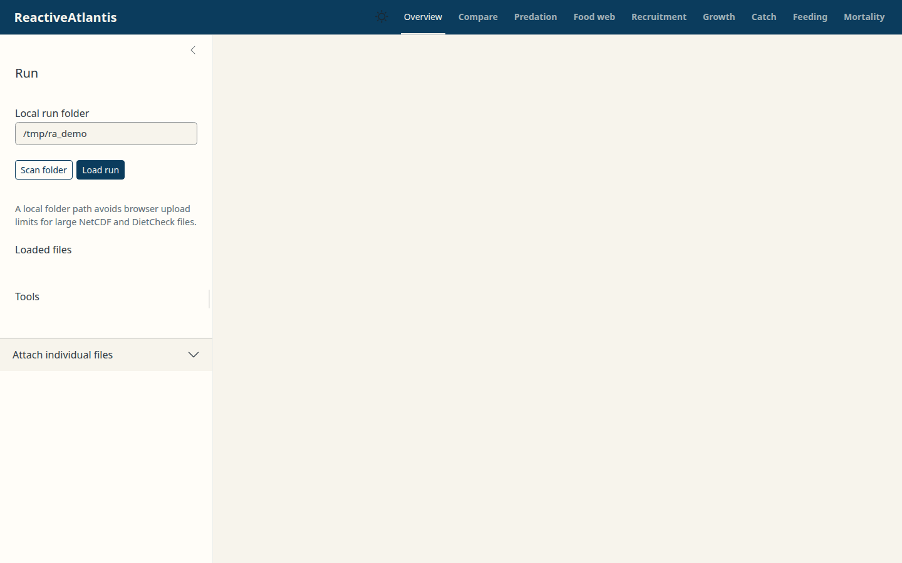

## Install

```r
install.packages("remotes")
remotes::install_github("jporobicg/ReactiveAtlantis", dependencies = TRUE)
library(ReactiveAtlantis)
```

This installs the default branch. To try a branch that is not merged yet,
add `ref = "<branch name>"`.

Requires R 4.0 or later, and the NetCDF and PROJ system libraries. On Debian
or Ubuntu, install `plotly` from CRAN rather than the `r-cran-plotly`
package: that package ships a replaced `typedarray.min.js` that stops plotly
charts from drawing.

## How to use the app

```r
library(ReactiveAtlantis)

## Configuration + output folders — preferred for large NetCDF / DietCheck files
launch_reactiveatlantis(
  config_dir = "/path/to/Atlantis/config",
  output_dir = "/path/to/Atlantis/output"
)

## One mixed folder still works
launch_reactiveatlantis(project_dir = "/path/to/Atlantis/output")

## Or open the app and paste the folder paths in the Run sidebar
launch_reactiveatlantis()
```

1. Point the **Run** sidebar at a configuration folder (groups CSV, `.prm`,
   init NetCDF, BGM) and an output folder (`*BiomIndx.txt`, `*DietCheck.txt`,
   `*CATCH.nc`, `*PROD.nc`). Leave one blank to use the other as a single
   folder. Files are detected by suffix and header (`pPREY` vs `toutinc` in
   `.prm`). A file found only in the other folder is kept and marked
   “loaded (other folder)”. `outputPROD.nc` is never treated as the biology
   output NetCDF.
2. Click **Load run**. The checklist shows which files are present and which
   tools are enabled. A tool whose files are missing stays on a short “needs”
   card instead of a blank plot. A **Working…** chip and plot/table spinners
   show when the app is busy.

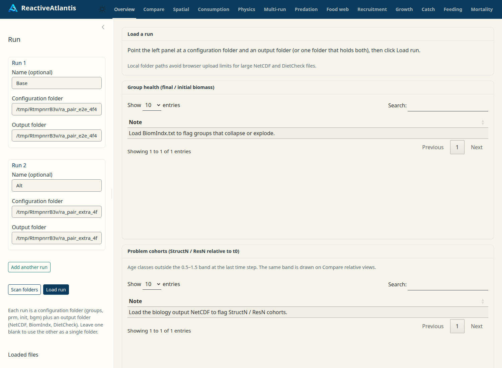

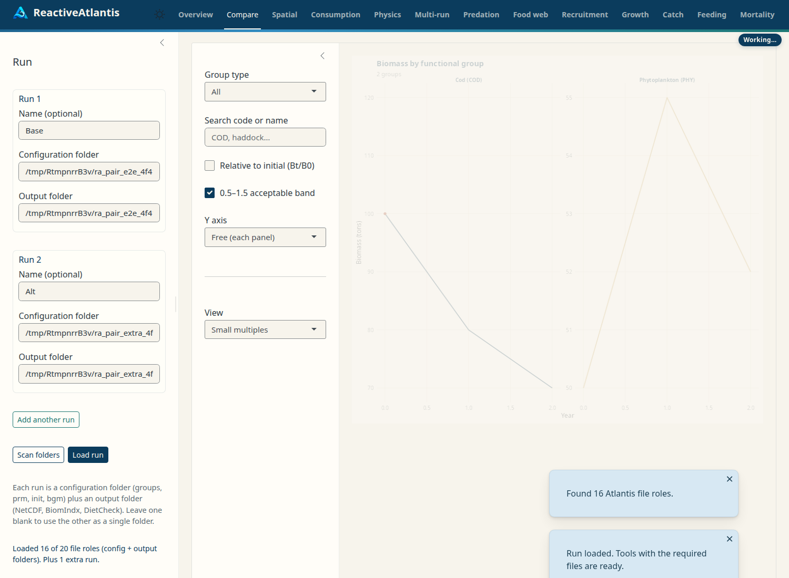
3. Optional: click **Add another run** for the Multi-run tab (each extra run
   is also a config + output pair), and attach an observations CSV
   (`Code, Year, Value, Lower, Upper, Type` where Type is `Biomass`, `SSB`
   or `Recruitment`).
4. Start on **Overview**. Summary cards (groups, boxes, layers, time span in
   years, start date from the NetCDF time units) sit above a sortable health
   table: groups that fall below 1% of initial biomass, or grow more than
   tenfold, plus age classes whose mean StructN or ResN at the end of the run
   sits outside 0.5–1.5 of the initial value.
5. Use the other tabs as usual. Dark mode is the toggle in the navbar.

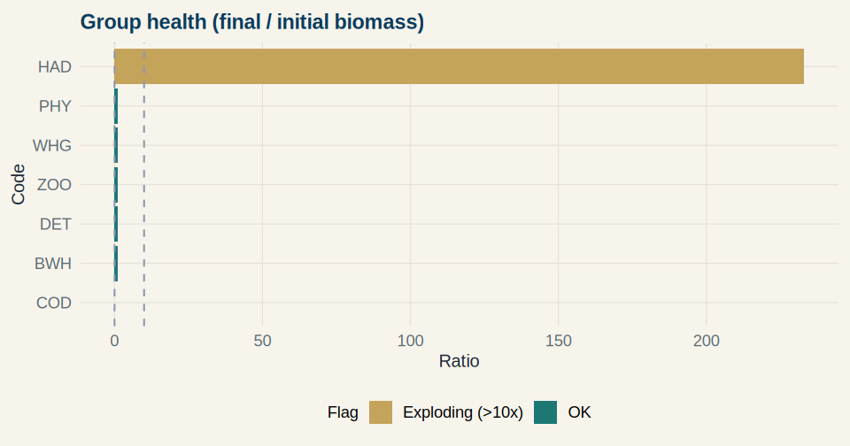

### Views

| Tab | What you get |
| --- | --- |
| Compare | Faceted biomass with free y, GroupType / search filter, relative-to-initial toggle, optional 0.5–1.5 band on relative views, age-structure bars, observed biomass points |
| Spatial | Biomass per box from `.bgm` polygons, depth-layer selector (each water layer, sediment, integrated), time slider, optional stable colour scale, per-box series; dark box outlines |

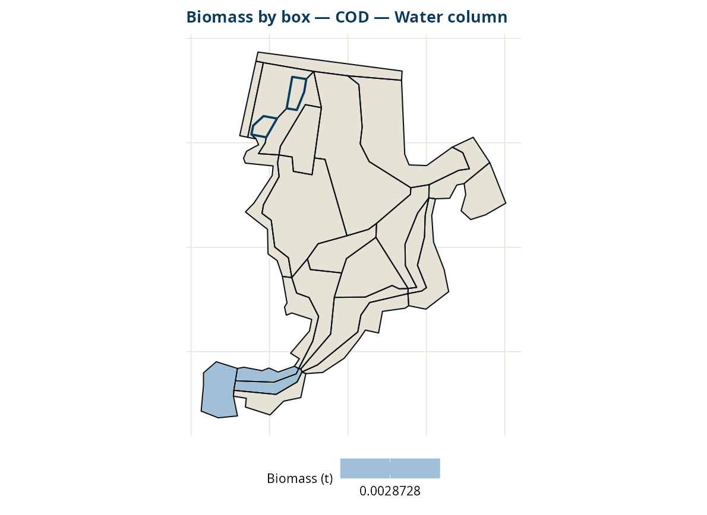

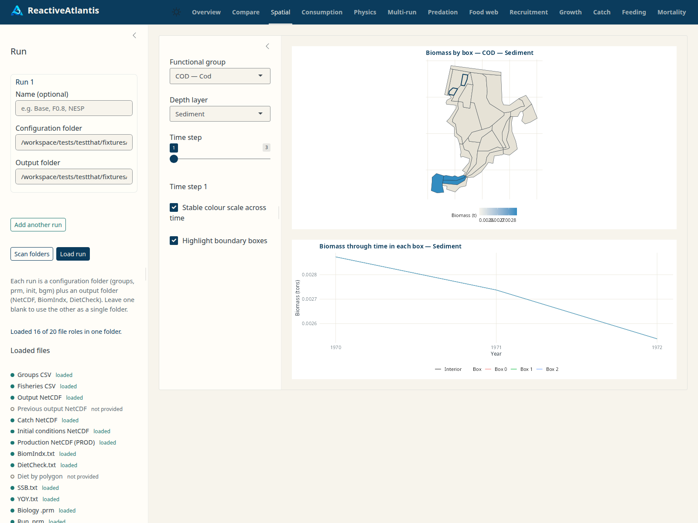
| Ages | Biomass, numbers, reserve and structural N by age class |
| Consumption | Food intake (t/day) as Atlantis realises it: for age-structured groups, numbers × `<Name><cohort>_Growth` (outputPROD.nc) ÷ E, split by each cohort's DietCheck shares. Pools still use `<name>Grazing` × volume and are not validated. Predator and prey views. Disabled if PROD is missing |
| Physics | Temperature, salinity, NO3, NH3, Chl_a and denitrification by box and the water/sediment layers that exist in that box, plus `nominal_dz` |
| Multi-run | Overlay biomass, SSB, YOY or catch from extra run pairs; ensemble mean and range when more than two runs are loaded |
| Predation | Stacked diet composition, top N prey plus Other, year axis |
| Food web | Interactive network (visNetwork when installed) with a time slider |
| Recruitment | Beverton–Holt alpha/beta in a side panel; SSB view; observed Recruitment / SSB ribbons |
| Growth | Light / nutrient / eddy limitation by layer, years on the x-axis |
| Catch | **Not validated against a fished run.** Stacked catch by group or fleet (tonnes from `{Code}_Catch_FC{fleet}`, fleet = row in the fisheries CSV, or `Tot_{Code}_Catch`); numbers by age; observed overlay and skill when a catch CSV is loaded |
| Feeding | pPREY matrix (cells with pPREY > 0 and no gape overlap are flagged); predation-pressure **screening index** (a simplified Holling calculation, not Atlantis intake; the realised intake is shown beside the selected pair); realised diet; diagnostics |
| Mortality | Fishing, natural and predation mortality stacked per age; predation mortality on a group split by predator (SpecificPredMort.txt: rows are prey, columns predators); Mort.txt F vs M |

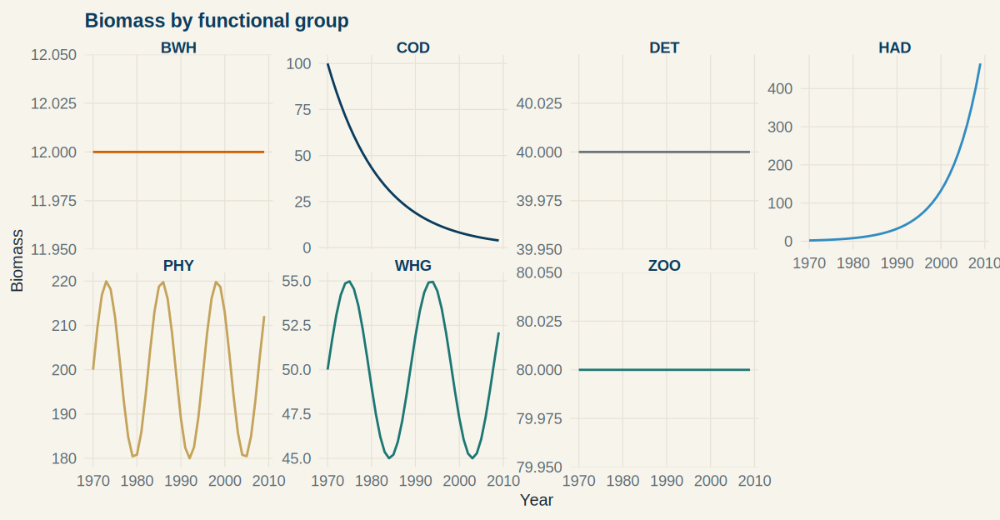

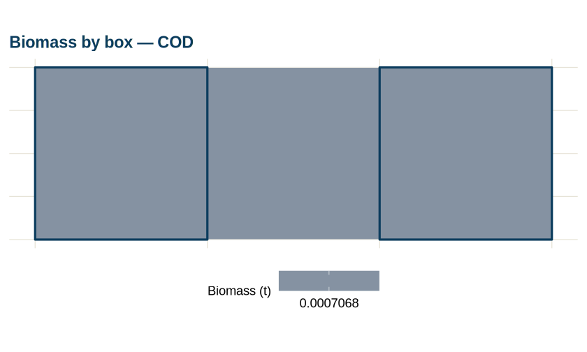

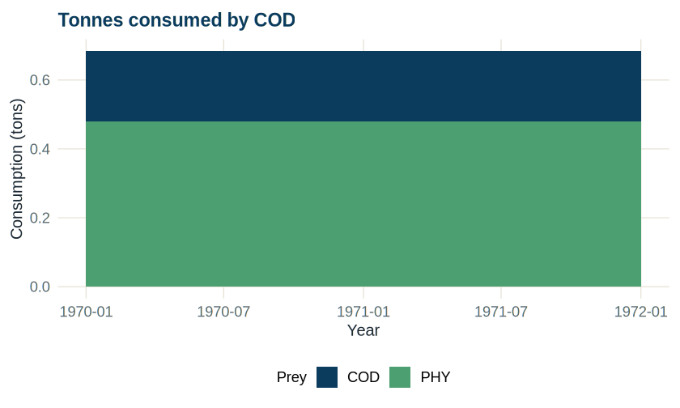

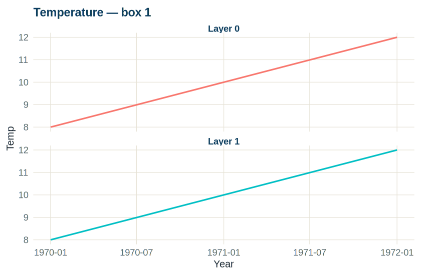

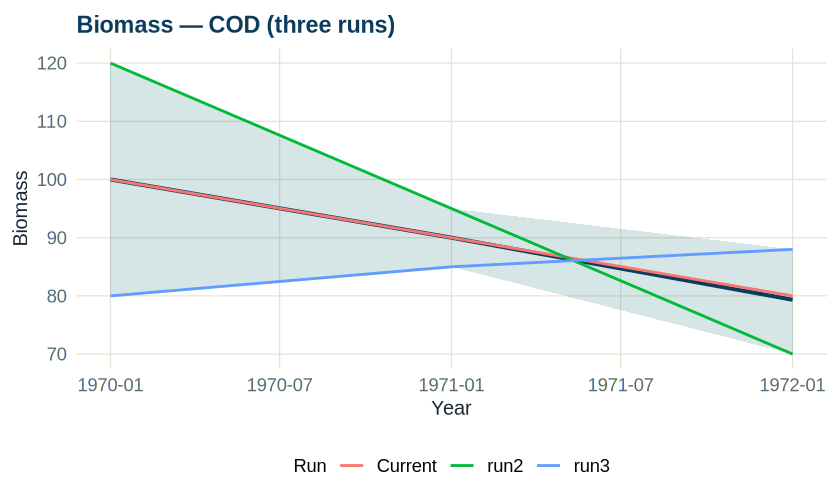

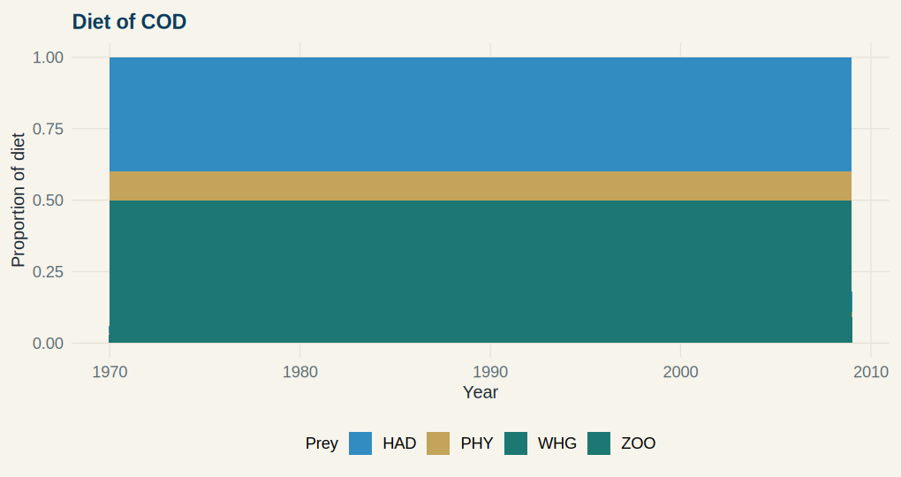

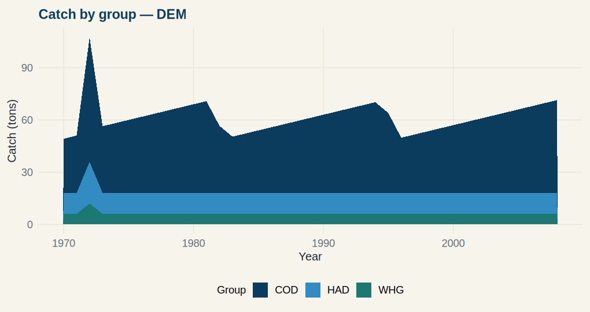

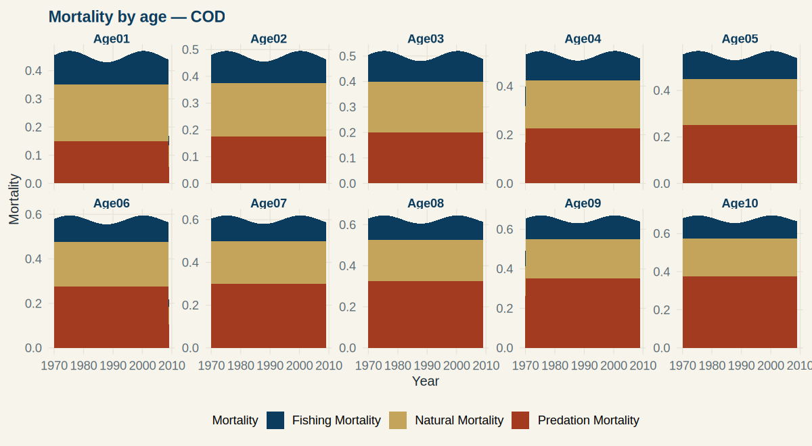

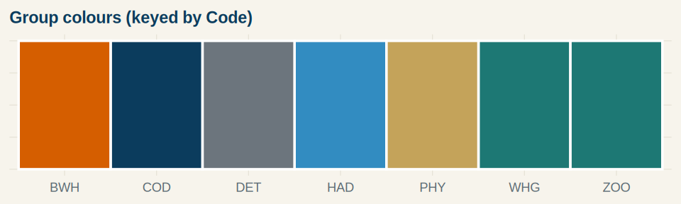

Colours are keyed by functional-group **Code** (groups CSV order, GroupType hue
families). The same code is the same colour in every tool. Current vs previous
runs stay firebrick / olive.

Time axes use years from the NetCDF time units, not raw seconds or days. Plots
share `theme_reactiveatlantis()`. Time series use plotly when the view is small
enough to hover.

## Atlantis Scientific Guide (optional, experimental)

**Experimental.** In a 55-question test against the Atlantis source and
manuals, about one answer in three contained a scientific error, sometimes
with a citation attached. Check every answer against the manual or the
model output before acting on it. The Guide never edits files or runs
Atlantis. Reasoning output is switched off by default (`RA_OLLAMA_THINK`),
because reasoning models were too slow on a CPU.

An optional **Atlantis Scientific Guide** drawer (the existing local
Ask Atlantis stack) can answer modelling questions from a local index
and point you at the existing tools above. When enabled, a speech-bubble
button at the bottom-right opens a right-hand drawer from any tab. While a
reply or index build is in progress the drawer shows **Thinking…**. It is off
unless you set `RA_AI_ENABLED=true`, install [Ollama](https://ollama.com) on
the same machine, and build the index. It never calls a cloud LLM. User and
maintenance notes are in [`docs/ai/`](docs/ai/). Setup of the index is in
[`inst/ai/README.md`](inst/ai/README.md). Tests use a clearly marked fixture
corpus plus this package’s own help. CSIRO user-guide PDFs can be downloaded
locally (they are not shipped in the package) and indexed with
`inst/ai/sources.atlantis-manuals.json`.

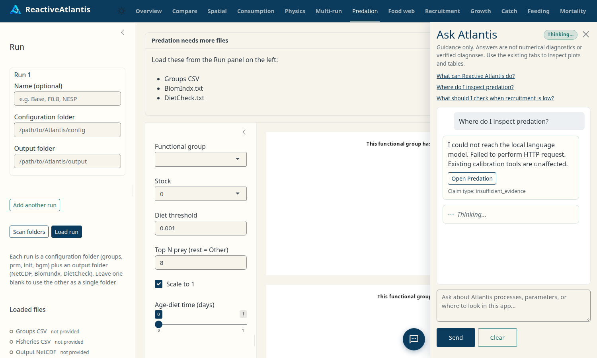

## Legacy functions

The original exported functions still open their own apps for scripts:

```r
compare(nc.out.current, nc.out.old = NULL, grp.csv, bgm.file, cum.depths)
predation(biom.file, groups.csv, diet.file, age.biomass = NULL)
feeding.mat(prm.file, grp.file, nc.file, bgm.file, cum.depths, quiet = TRUE)
food.web(diet.file, grp.file, diet.file.bypol = NULL, quiet = TRUE)
growth.pp(ini.nc.file, grp.file, prm.file, out.nc.file)
recruitment.cal(ini.nc.file, out.nc.file, yoy.file, grp.file, prm.file, quiet = TRUE)
catch(grp.csv, fish.csv, catch.nc, ext.catch.by.fleet = NULL, ext.catch.total = NULL)
mortality(grp.file, prm.file, SpeMort, PredMort)
```

## Authors

Javier Porobic

## License

[GPL-3](https://www.gnu.org/licenses/gpl-3.0.en.html)
