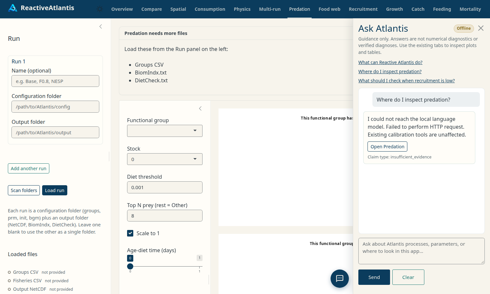

# Ask Atlantis (optional local guidance)

A small, optional drawer in the unified ReactiveAtlantis app. It answers
questions from a **local** index (manuals, code, calibration notes) using a
**local** Ollama model, and it points you at existing tabs. It does not run
Atlantis, edit parameters, or replace any plot or table in the app.

Disabled by default (`RA_AI_ENABLED=false`). When it is off, or when Ollama
is missing, the rest of the app behaves as before. When it is on, a
speech-bubble button at the bottom-right opens a right-hand drawer from any
tab; the drawer is closed by default and does not cover plots.



## Set up (developers)

1. Install [Ollama](https://ollama.com) and pull a chat model plus embeddings:

   ```bash
   ollama pull qwen3.5:4b
   ollama pull nomic-embed-text
   ollama list
   ```

   A smaller chat model such as `qwen3.5:2b` is fine. Set `RA_OLLAMA_MODEL`
   to whatever you pulled. Do not hard-code a single family in your own
   wrappers; the app already reads the environment.

2. Install optional R packages (Suggests): `httr2`, `jsonlite`, `RSQLite`,
   `DBI`. For PDF manuals, also `pdftools`.

3. Point the sources manifest at your corpus. The packaged
   `inst/ai/sources.json` indexes a **fixture** corpus plus this package’s
   own source (used by tests). For the CSIRO user-guide PDFs listed on
   [Accessing Atlantis](https://research.csiro.au/atlantis/home/links/):

   ```bash
   Rscript inst/ai/download_atlantis_manuals.R
   ```

   The PDFs are CSIRO copyright and are **not** committed to git. They land
   in `RA_AI_CORPUS_DIR` (default: the ReactiveAtlantis user data directory).
   Then set `RA_AI_SOURCES_CONFIG` to `inst/ai/sources.atlantis-manuals.json`.
   Copy `inst/ai/sources.example.json` when you also have Atlantis source or
   calibration notes.

4. Build the index (does not run on every app start):

   ```r
   library(ReactiveAtlantis)
   index_ask_atlantis()              # skip unchanged files
   diagnose_ask_atlantis_index()
   ```

   Or from the package root:

   ```bash
   Rscript inst/ai/index.R --no-embed
   Rscript inst/ai/index.R --diagnose
   ```

   For CSIRO manuals, set `RA_AI_SOURCES_CONFIG` first:

   ```bash
   export RA_AI_SOURCES_CONFIG="$(pwd)/inst/ai/sources.atlantis-manuals.json"
   Rscript inst/ai/index.R --no-embed
   ```

5. Enable the drawer and launch:

   ```r
   Sys.setenv(RA_AI_ENABLED = "true")
   # optional:
   # Sys.setenv(RA_OLLAMA_URL = "http://127.0.0.1:11434")
   # Sys.setenv(RA_OLLAMA_MODEL = "qwen3.5:4b")
   # Sys.setenv(RA_OLLAMA_EMBED_MODEL = "nomic-embed-text")
   # Sys.setenv(RA_AI_INDEX_DIR = "/path/to/index")
   # Sys.setenv(RA_AI_SOURCES_CONFIG = "/path/to/sources.json")
   launch_reactiveatlantis()
   ```

## Troubleshooting

| Symptom | What to check |
| --- | --- |
| No speech-bubble button | `RA_AI_ENABLED` is not `true` |
| Badge says Offline | Ollama is not running on `RA_OLLAMA_URL` |
| Badge says Model missing | `ollama pull` the name in `RA_OLLAMA_MODEL` |
| Empty or weak answers | Index missing or still on fixtures; run `diagnose_ask_atlantis_index()` |
| PDF pages missing | Install `pdftools`; inspect ingest_log failures |
| App frozen | Should not happen; generation uses `ExtendedTask` and a timeout. Other tabs stay usable. |

Nothing is sent to a cloud LLM. If Ollama is down, the panel says so; it does
not switch to a remote API.

## Evaluation questions

`inst/ai/evaluation/questions.json` is a 24-question set (success, ambiguous,
unsupported, adversarial) with expected source types, nav ids, and a 0–2
rubric. Retrieval-only scoring:

```bash
Rscript inst/ai/evaluation/run_eval.R
Rscript inst/ai/evaluation/run_eval.R --sources inst/ai/sources.atlantis-manuals.json
```

Add `--model` only when a live Ollama chat model is installed. The second
command reports which questions retrieve passages from the downloaded CSIRO
PDFs (`real_manual`).

## Security / scientific limits

- Read-only: no file writes, no shell, no simulation launch from the chat.
- Navigation targets and citation ids are checked in R before display.
- Retrieved text is treated as data, not as instructions.
- Calibration notes are examples, not universal parameter rules.
- The assistant cannot see plot pixels or NetCDF values from the loaded run.
